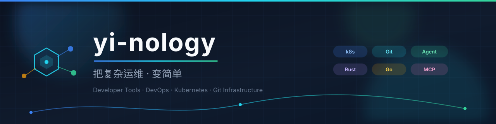

  

  

    
    
    
    
  

  

    <em>Developer tools for Kubernetes, Git infrastructure, and Agent-native ops.</em> 
    面向研发与运维的工具箱：可视化监控、Git 同步、诊断技能链、微服务脚手架。
  

---

## 🧭 产品矩阵

<table>
<tr>
<td width="50%" valign="top">

###  &nbsp;k7s
**Lens 风格 · Kubernetes 全平台监控**

Tauri 2 + Rust + React。桌面 / Web / iPad / Android 四形态，实时资源、拓扑、可观测、安全审计、AI 助手 + 96 个 MCP 工具。

</td>
<td width="50%" valign="top">

###  &nbsp;GitFerry「摆渡」
**跨网同步 · 开源发布 · 冷备容灾**

一站式 Git 同步微服务：GitHub / GitLab / Gitee / Gitea 多平台任务同步、元数据可恢复冷备、模块身份重写、Agent 原生 CLI + MCP。

</td>
</tr>

<tr>
<td width="50%" valign="top">

###  &nbsp;go-git-platform
**7 大 Git 平台 · 统一 Go SDK**

GitHub / GitLab / Gitea / Forgejo / Gitee / GitCode / 工蜂统一接口 + 本地 git 后端 + CI 失败诊断 + MCP Server。

</td>
<td width="50%" valign="top">

###  &nbsp;bianque 扁鹊
**运维诊断 · 技能 / 专家 / 诊断链**

领域包（pack）式运维诊断资产：OS / K8s / 中间件 / 数据库 / CI-CD / 可观测，一键导入，兼容 Agent Skills。

</td>
</tr>

<tr>
<td width="50%" valign="top">

###  &nbsp;禅道系 · ZenTao
**轻量项目管理与发布中心**

zentao-mini / zentao-max / zentao-release-center — 桌面友好、Go 实现的项目管理与发布工具链。

</td>
<td width="50%" valign="top">

###  &nbsp;SidecarOneStep「随航一步」
**macOS Sidecar 一键增强**

一键连接 iPad 随航、远程控制、自动化集成、MCP 接入。

</td>
</tr>
</table>

---

## 🛠 技术栈

  

  

  
  
  
  
  
  

---

## 📦 更多仓库

| 方向 | 仓库 | 说明 |
|:--|:--|:--|
| 🏗 脚手架 | [cloudwego-template](https://github.com/yi-nology/cloudwego-template) · [scaffold](https://github.com/yi-nology/scaffold) | CloudWeGo Hertz/Kitex 微服务模板、全套业务脚手架 |
| 🤖 Agent | [agentkit](https://github.com/yi-nology/agentkit) · [pulse](https://github.com/yi-nology/pulse) | Agent 工具箱与轻量服务 |
| 🌉 工程 | [rainbow_bridge](https://github.com/yi-nology/rainbow_bridge) · [git-manage-service](https://github.com/yi-nology/git-manage-service) | 静态资源通道、Git 管理服务 |
| 🧰 工具 | [common](https://github.com/yi-nology/common) · [sdk](https://github.com/yi-nology/sdk) · [shell](https://github.com/yi-nology/shell) | Go 公共库、SDK、常用脚本 |
| 🌐 站点 | [cv](https://github.com/yi-nology/cv) · [murphyyi.com](https://github.com/yi-nology/murphyyi.com) · [ework](https://github.com/yi-nology/ework) | 个人主页、官网、导航站 |
| 📱 移动 / 桌面 | [k7s-desktop](https://github.com/yi-nology/k7s-desktop) · [k7s-ios](https://github.com/yi-nology/k7s-ios) · [k7s-android](https://github.com/yi-nology/k7s-android) | k7s 多端形态 |

---

## 📊 数据一览

  
  

 

  

---

## 🔗 导航

 

  © yi-nology · Built with ❤️ in Beijing · <a href="https://github.com/yi-nology">github.com/yi-nology</a>

