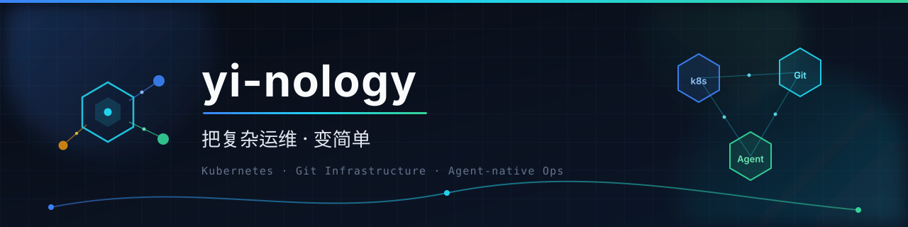

  

  

    <em>Developer tools for Kubernetes, Git infrastructure &amp; Agent-native ops.</em> 
    面向研发与运维团队的 Go / Rust / TypeScript 工具箱——把集群、代码仓库与智能体，接进同一套可观测、可编排、可交付的工程链路。
  

  

    
    
    
    
  

---

## 产品矩阵

<table>
<tr>
<td width="33%" valign="top">

**k7s**
Lens 风格 · Kubernetes 可视化监控

Tauri 2 + Rust + React 构建的集群监控与运维工具：实时资源表格、服务拓扑、PromQL 即时查询、RBAC 越权审计，内置 AI 助手与 96 个 MCP 工具。桌面 / Web / iPad / Android 四形态。

[`k7s-core`](https://github.com/yi-nology/k7s-core) [`k7s-server`](https://github.com/yi-nology/k7s-server) [`k7s-frontend`](https://github.com/yi-nology/k7s-frontend) [`k7s-desktop`](https://github.com/yi-nology/k7s-desktop) [`k7s-ios`](https://github.com/yi-nology/k7s-ios) [`k7s-android`](https://github.com/yi-nology/k7s-android)

`Rust` `TypeScript` `Tauri 2`

</td>
<td width="33%" valign="top">

**GitFerry「摆渡」**
跨网 Git 同步微服务

一站式 Git 同步中枢：任务式跨平台同步（cron / webhook / 手动）、开源发布镜像仓、可恢复冷备、双仓历史回迁。健康分 / RPO / 漂移检测 / 审计哈希链，CLI + MCP + Agent Skills 三种驱动。

[`git-ferry-core`](https://github.com/yi-nology/git-ferry-core)

`Go` `MCP` `Agent Skills`

</td>
<td width="33%" valign="top">

**go-git-platform**
7 大 Git 平台 · 统一 Go SDK

GitHub / GitLab / Gitea / Forgejo / Gitee / GitCode / 工蜂共用一套接口。17 个可选能力接口按需声明，凭证轮转、幂等 ensure、CI 失败日志诊断、字段投影，附 MCP Server。

[`go-gitcode`](https://github.com/yi-nology/go-gitcode)

`Go` `SDK` `MCP`

</td>
</tr>
<tr>
<td width="33%" valign="top">

**bianque 扁鹊**
智能运维多智能体平台

望闻问切——采集、判读、根因、方案。专家即外置领域包，接入新领域只放包不改平台代码；控制台 / MCP 工具面 / OpenAI 兼容端点 / 外部接入面，四条对外通路。

`Go` `Agent` `MCP`

</td>
<td width="33%" valign="top">

**code-review-service**
AI 代码评审网关

接入 GitHub / GitLab / Gitea / Forgejo / Gitee / GitCode / 工蜂 / Gerrit，用 Open Code Review 做多智能体评审，把可执行的反馈回写为行内评论与 commit status。

`Go` `Agent` `Code Review`

</td>
<td width="33%" valign="top">

**rainbow_bridge 虹桥**
配置与资源管理平台

编辑有工作区，发布有快照，业务读取有明确版本。文案、主题色、JSON、图片与文件的统一管理，网站 / 客户端 / 后端服务通过 API 读取当前版本，也可锁定指定版本。

`Go` `配置管理`

</td>
</tr>
<tr>
<td width="33%" valign="top">

**zentao 禅道系**
轻量项目管理与发布中心

Wails + Vue 桌面端项目管理，HTTP API 对接禅道数据；发布单管理、部署地址记录、发布快照与 Markdown / HTML 导出。

`Go` `Wails` `Vue`

</td>
<td width="33%" valign="top">

**SidecarOneStep「随航一步」**
macOS Sidecar 一键增强

一键连接 iPad 随航、远程控制、自动化集成与 MCP 接入。把 macOS 原生 Sidecar 从「能连」变成「好用」。

`macOS` `MCP`

</td>
<td width="33%" valign="top">

**Agent 基础设施**
编排是代码，记忆是代码

LLM 只做单环节、只做单次提炼——编排层与记忆层都由代码兜底。agent-harness 管编排执行，agent-memory 管跨会话长期记忆，pulse 提供轻量服务骨架。

[`agent-memory`](https://github.com/yi-nology/agent-memory) [`pulse`](https://github.com/yi-nology/pulse)

`Go` `Agent` `Memory`

</td>
</tr>
</table>

---

## 更多仓库

| 方向 | 仓库 | 说明 |
|:--|:--|:--|
| 脚手架 | [`cloudwego-template`](https://github.com/yi-nology/cloudwego-template) · [`scaffold`](https://github.com/yi-nology/scaffold) | CloudWeGo Hertz/Kitex 微服务模板、全套业务脚手架 |
| 工程与工具 | [`git-manage-service`](https://github.com/yi-nology/git-manage-service) · [`iam-deploy`](https://github.com/yi-nology/iam-deploy) · [`promQLInsights`](https://github.com/yi-nology/promQLInsights) · [`sdk`](https://github.com/yi-nology/sdk) · [`shell`](https://github.com/yi-nology/shell) | Git 管理服务、IAM 部署、PromQL 分析、Go SDK、常用脚本 |
| 站点与内容 | [`yi-nology.github.io`](https://github.com/yi-nology/yi-nology.github.io) · [`cv`](https://github.com/yi-nology/cv) · [`ework`](https://github.com/yi-nology/ework) · [`go-book`](https://github.com/yi-nology/go-book) | 组织官网、个人主页、导航站、Golang 入门书 |
| 简历与演示 | [`resume`](https://github.com/yi-nology/resume) · [`resume-go`](https://github.com/yi-nology/resume-go) · [`mdresume`](https://github.com/yi-nology/mdresume) · [`film`](https://github.com/yi-nology/film) · [`WechatShare`](https://github.com/yi-nology/WechatShare) | 简历前后端、简历编写、演示项目 |
| 归档 | [`agentkit`](https://github.com/yi-nology/agentkit) · [`common`](https://github.com/yi-nology/common) · [`zentao-release-center`](https://github.com/yi-nology/zentao-release-center) · [`home-system`](https://github.com/yi-nology/home-system) · [`home-system-f2e`](https://github.com/yi-nology/home-system-f2e) · [`sso-system`](https://github.com/yi-nology/sso-system) · [`wifi-qr`](https://github.com/yi-nology/wifi-qr) | agentkit 已迁移至 `oagentkit/*`；其余不再维护 |

---

## 技术栈

  

主力 Go / Rust / TypeScript · 云原生 Kubernetes / Docker · Agent / MCP

---

## 成员

  
    
  <a href="https://github.com/zy84338719">MurphyYi</a>

---

[全部仓库](https://github.com/orgs/yi-nology/repositories) · [组织官网](https://yi-nology.github.io) · [murphyyi.com](https://murphyyi.com) · [k7s](https://github.com/yi-nology/k7s) · [GitFerry](https://github.com/yi-nology/git-ferry)

© yi-nology · 把复杂运维变简单

